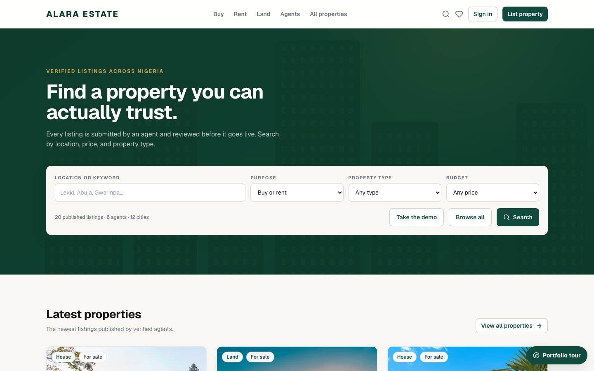
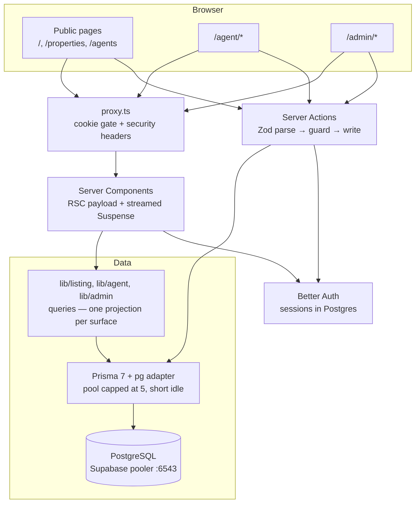
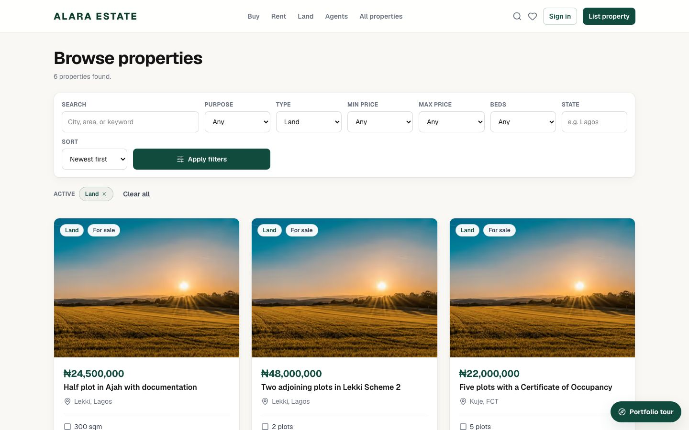
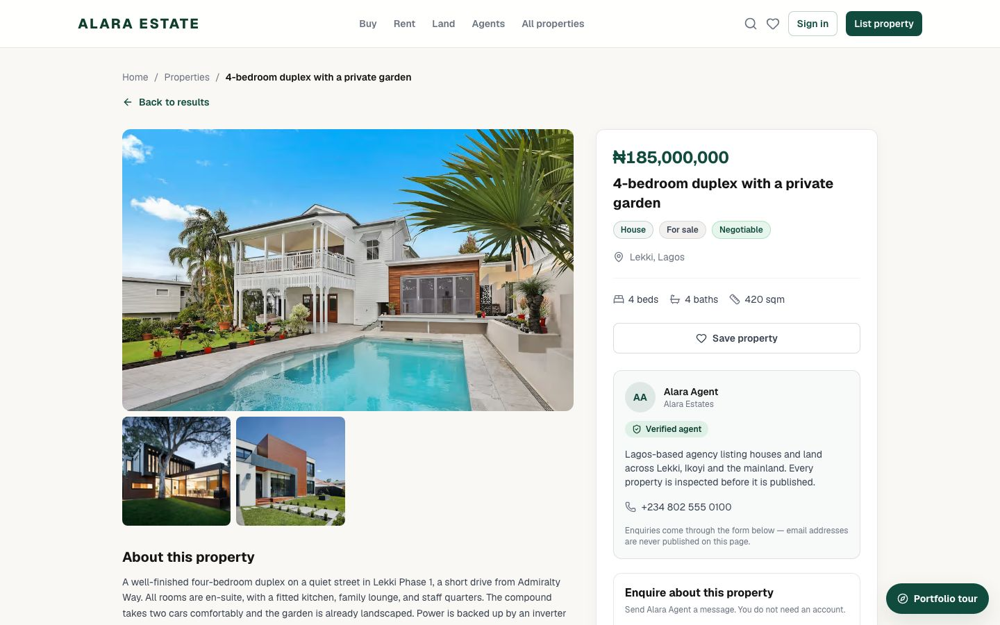
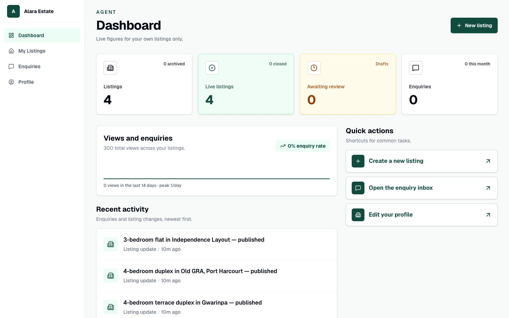
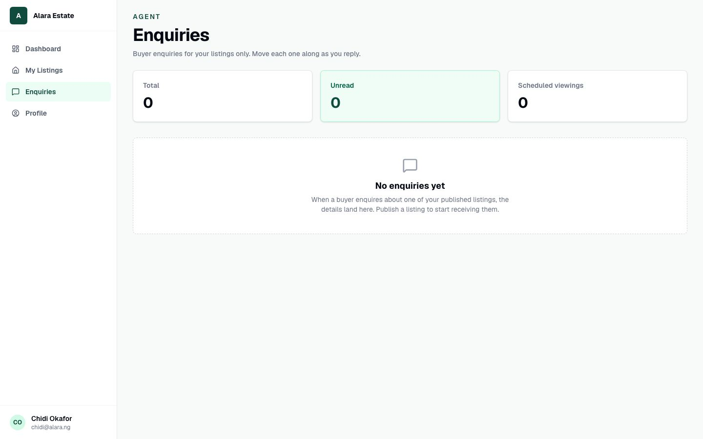
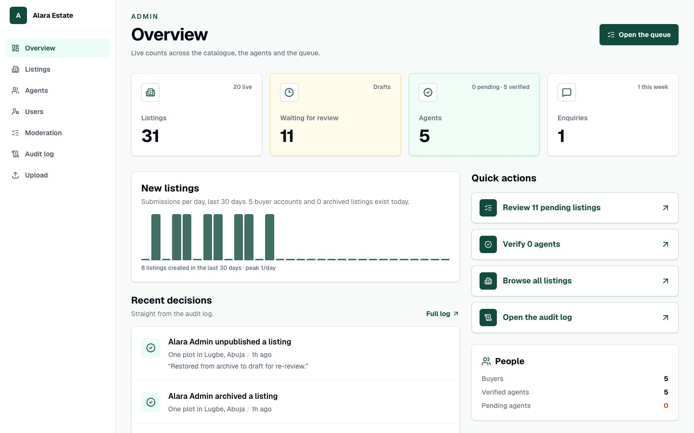
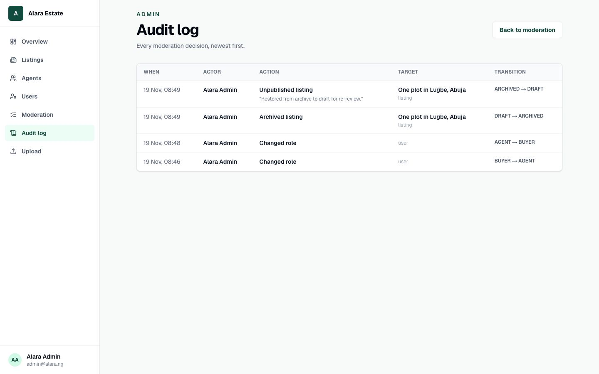
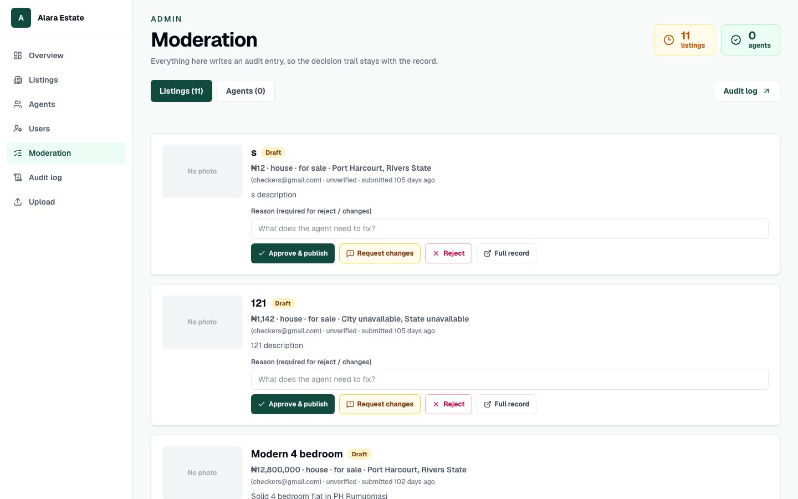
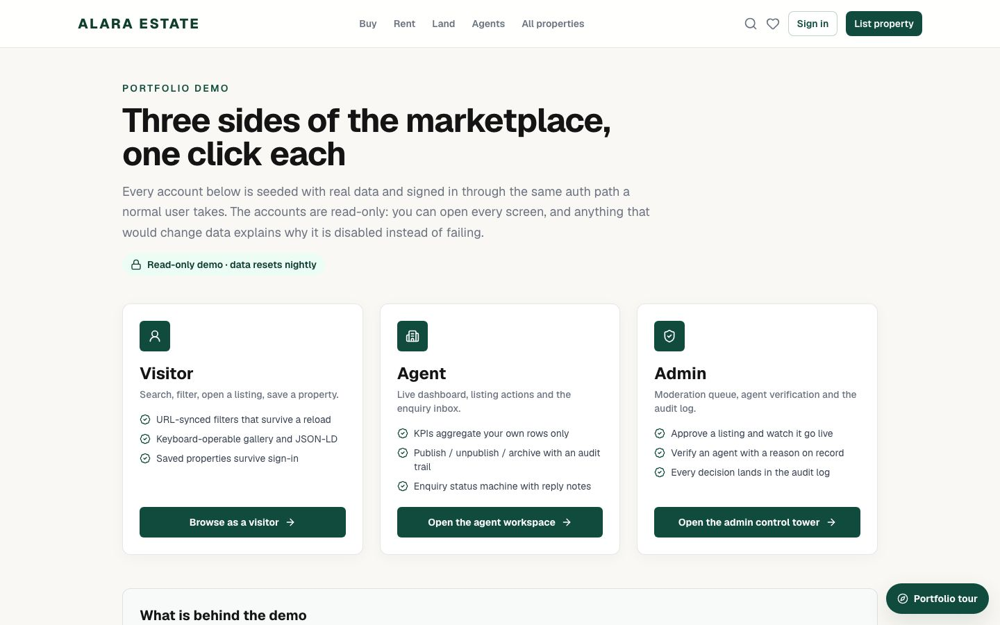

# Alara Estate

**A property marketplace where nothing is listed until a human has approved it.**

Three personas, one database: buyers search verified houses and land, agents work their own
listings and enquiries, admins moderate the catalogue and keep an audit trail of every
decision. Next.js 16 App Router · PostgreSQL · Prisma 7 · Better Auth · Cloudinary.

```bash
git clone https://github.com/AYG3/real-listings && cd real-listings
npm install && cp .env.example .env.local   # add DATABASE_URL + BETTER_AUTH_SECRET
npm run db:migrate && npm run db:seed && npm run dev
```

### Explore it as…

| | | |
| --- | --- | --- |
| **[Browse the listings](http://localhost:3000/properties)** | **[Open the agent workspace](http://localhost:3000/demo)** | **[Open the admin control tower](http://localhost:3000/demo)** |
| no account needed — filters, gallery, guest enquiry | live KPIs, listing actions, enquiry inbox | moderation queue, agent verification, audit log |

The three links in `/demo` sign in through the real auth endpoint with seeded accounts and are
**read-only by design** (see [demo mode](#demo-mode)). Locally you can also sign in as
`admin@alara.ng` / `AlaraAdmin1!` for the full write experience.

> **Status:** Phases 0–7 of the [readiness plan](plans/01-portfolio-readiness-plan.md) are
> complete. Not deployed yet — no Vercel credentials in this environment — so the links above
> are local. `npm test` runs 91 unit tests; CI runs lint → typecheck → test → build.



### The problem, in four lines

1. Nigerian listing sites are full of duplicates, dead links and unverified "agents" — the
   buyer pays the cost of finding that out.
2. Most marketplace clones model listings and stop there: no review step, no ownership rules,
   no record of who changed what.
3. Alara Estate makes **approval the default path** to publication, and makes every
   administrative decision **auditable by construction**.
4. The demo is the product: a reviewer can be inside a populated admin dashboard in two clicks.

## Stack

| Layer | Choice | Why |
| --- | --- | --- |
| Framework | Next.js 16, App Router, React 19 | Server components keep data fetching on the server and the client bundle small. |
| Language | TypeScript (strict) | Type safety across Prisma models, server actions, and UI props. |
| Database | PostgreSQL | Relational integrity for users, listings, images and enquiries. |
| ORM | Prisma 7 (`prisma-client` generator + `pg` adapter) | Typed queries and migrations. |
| Auth | Better Auth | Email/password + Google OAuth, sessions in Postgres, role-aware guards. |
| Media | Cloudinary via `next-cloudinary` | Direct browser uploads; only the secure URL and public id reach the database. |
| UI | Tailwind CSS v4, `lucide-react`, `sonner` | Fast, consistent, accessible primitives. |
| Validation | `zod` | One schema per mutation; server actions reject malformed input before touching the database. |

## Architecture



Three things are worth calling out because they are the ones that survive a code review:

- **Approval is a state machine, not a checkbox.** `DRAFT → PUBLISHED → UNDER_OFFER → SOLD |
  RENTED`, with `ARCHIVED` as the reversible exit. The transition table lives in
  [`listing/transitions.ts`](src/lib/listing/transitions.ts) and is unit-tested; publishing
  additionally requires a *verified* agent.
- **Every write is validated twice over.** A Zod schema per action (shared with the form that
  renders the errors) plus a guard per action. A test walks `src/app`, finds every
  `"use server"` module and fails the build if any exported action lacks either.
- **The audit row is written by the action that makes the change**, with the actor, the
  from/to status and the reason the admin typed. See
  [ADR 0002](docs/decisions/0002-audit-in-action.md) for what that buys and what it costs.

Full detail: [docs/architecture.md](docs/architecture.md) and
[docs/authorization.md](docs/authorization.md).

## Who it is for

| Persona | What they need | What the app does |
| --- | --- | --- |
| **Buyer / renter** (no account) | Trust the listing, act on it now | URL-synced filters that survive a reload, keyboard-operable gallery, verified-agent card, guest enquiry, saves that survive sign-in |
| **Agent** | Know what is working, fix what is not | Live dashboard (views, enquiry rate, 14-day sparkline), listing actions with an audit trail, enquiry inbox with a status pipeline and reply notes |
| **Admin** | Keep the catalogue honest | Moderation queue with approve / reject / request changes, agent verification, users table with audited role changes, append-only audit log |
| **Reviewer** (recruiter, engineer) | Understand the system in two minutes | One-click read-only demo per role, a 90-second script, a case study with the decisions behind it |

## What works today

- **Public discovery:** `/properties` with URL-synced filters (`q`, intent, type, state, city, price band, beds, sort), pagination and active-filter chips. Every combination is a shareable, reloadable URL that works without JavaScript.
- **Listing detail pages** at `/properties/[slug]` with keyboard-operable gallery, type-specific facts (beds/baths/sqm or plots/title/survey), description, similar listings, verified-agent card and JSON-LD.
- **Guest enquiries:** anyone can message the agent without an account. Validated with zod, honeypot-protected, rate limited to 5/hour per IP, and stored in Postgres (`buyerId` is null for guests, set when signed in).
- **Save properties:** optimistic save button; guests keep saves in `localStorage` and they merge into `SavedListing` on the next signed-in view.
- **View tracking:** each detail render increments `viewCount` and records a `ListingView` after the response is sent.
- **Agent directory** at `/agents` and per-agent profiles at `/agents/[id]`, both reading live data.
- **Preset routes** `/buy`, `/rent`, `/land` that reuse the results page instead of duplicating queries.
- **Real counts on the homepage** (`listing.count` + `groupBy`) and a hero search that actually navigates.
- Email/password and Google sign-in through one role-aware `/login` (a portal deep link like `/admin/overview` sends you there with the right gate).
- Role-based protection for the agent (`/agent/*`) and admin (`/admin/*`) portals, enforced in the proxy, the layout **and** every server action.
- **Agent workspace** at `/agent/dashboard`: live counts, views, enquiry rate, a 14-day views sparkline and an activity feed, all aggregated from the agent's own rows.
- **Agent listings** with search, status/type filters and sorting, plus working row actions — Edit, Publish, Unpublish, Mark under offer, Mark sold, Archive, Restore — as guarded server actions. Verified agents can publish directly; unverified ones stay in review.
- **Listing editing** at `/agent/listings/[id]/edit`, including photo reordering, "set as cover" and removal, capped at 12 images.
- **Enquiry inbox** at `/agent/enquiries`: filters, search, buyer contact details, reply notes, and `NEW → CONTACTED → VIEWING_SCHEDULED → CLOSED` transitions.
- **Agent profile** editing (name, phone, agency, bio, avatar) with the verification state shown.
- Agent listing creation with Cloudinary image upload, ordered images and a cover image. New submissions from unverified agents enter moderation as drafts.
- Admin listing table with search, status filters, and a listing detail view.
- **Admin control tower** at `/admin/overview`: real listing/agent/buyer/enquiry counts, a 30-day submissions chart and the latest decisions from the audit log.
- **Moderation queue** at `/admin/moderation`: approve a draft to publish it, or reject / request changes with a reason that lands on the agent's listing card.
- **Agent verification** in the same queue: verify or reject an account; the verified badge on the public profile reads the same column.
- **Audit log** at `/admin/audit`: who changed what, from which state to which, with the reason attached.
- **Read-only demo** at `/demo`: three one-click identities (visitor, agent, admin) that sign in through the real auth endpoint, a persistent read-only banner, `npm run demo:reset` for the nightly reset, and a dismissible portfolio tour on public pages.
- **Case study** at `/case-study`: problem, users, architecture, three engineering decisions with trade-offs, and the metrics table.
- **Users table** at `/admin/users`: roles, agent status, join date and activity per account, with an audited role change.
- **Type-to-confirm** dialogs on destructive actions (archive, reject listing, reject agent, change role), plus a read-only guard for demo accounts (`DEMO_MODE`).
- A single design system: one brand source (`src/lib/brand.ts`), one token palette (`globals.css`), and shared primitives in `src/components/ui/`.
- `sitemap.xml` and `robots.txt` generated from the live catalogue.

## Quality gates

- **91 unit tests** (`npm test`) over the validation schemas, formatters, filter parsing, status
  transitions, the public cache, and a boundary audit that fails when a server action loses its
  guard or its schema.
- `npm run lint` (0 warnings), `npm run typecheck`, and a production build, all clean and all run
  by CI in that order.
- Manual browser verification of every flow, recorded with its evidence in the
  [readiness plan](plans/01-portfolio-readiness-plan.md).

## In progress

- Buyer `/account` pages for saved listings and enquiries.
- Playwright E2E for the five critical paths (the flows are verified by hand today).
- A Lighthouse a11y score on five sampled pages — structurally covered, not yet measured.

## Demo mode

`/demo` is the front door for a reviewer. Three cards sign in through the real auth endpoint —
no mock session, no role switcher in a cookie:

| Identity | Lands on | Can do |
| --- | --- | --- |
| Visitor | `/properties` | search, filter, open a listing, save a property |
| Agent (`demo-agent@alara.ng`) | `/agent/dashboard` | see live KPIs, listing actions, the enquiry inbox |
| Admin (`demo-admin@alara.ng`) | `/admin/overview` | moderation queue, agent verification, audit log |

The accounts are **real users with real roles** — the demo admin genuinely has `role = ADMIN`,
so the demo proves the production authorization path rather than a parallel one. Read-only
behaviour is a separate `isDemo` flag checked at all 18 mutation sites: every write returns a
plain-language refusal ("This is a read-only demo account — every screen is open, but nothing
can be changed") instead of a stack trace, and a banner in the root layout says so before the
first click.

Because a visitor can still act as a *guest* (an enquiry has no account to guard), the dataset
is restored rather than frozen:

```bash
npm run demo:reset          # idempotent: clears guest noise, re-runs the seed
```

The HTTP equivalent is `POST /api/demo/reset` with an `x-demo-reset-secret` header, 404 unless
`DEMO_MODE=true`. Wire it to a nightly cron in the deployed environment.

## Engineering decisions and trade-offs

Three that shaped the codebase. Each is written up in full under [docs/decisions](docs/decisions).

| Decision | Chose | Gave up | Next step |
| --- | --- | --- | --- |
| **Type-specific listing fields** | A shared `listings` row plus a normalised `attributes jsonb` column, validated by one Zod schema | Postgres cannot enforce the shape, and filtering inside JSON needs an expression index | Promote the counts (beds/baths) to real columns once a third property type lands — [ADR 0001](docs/decisions/0001-json-attributes.md) |
| **Audit trail** | The action that makes the change also writes the audit row | Two statements, not one transaction: a crash in between loses the log entry for a change that happened | Wrap update + insert in `prisma.$transaction` if audit becomes a compliance requirement — [ADR 0002](docs/decisions/0002-audit-in-action.md) |
| **Public read caching** | A 15-second in-process TTL cache, cleared explicitly by every listing mutation | Not shared across instances; a second instance can serve 15 s of stale data | Move to Redis or `unstable_cache` once Cache Components is enabled and `revalidate` is honoured — [why not `unstable_cache`](docs/architecture.md#caching) |

Two smaller ones the code makes visible: **guest saves in `localStorage` merged on sign-in**
(no cookie soup, one reconcile point) and **`notFound()` for cross-tenant reads** (agents cannot
enumerate each other's listing ids by watching 403s).

## Metrics

Measured on this machine, production build, not projected numbers.

| Metric | Value | How |
| --- | --- | --- |
| Unit tests | **91 passing** | `npm test` (Vitest) |
| Server-action boundary coverage | **7/7 modules** guarded *and* parsed | [`actions.test.ts`](src/lib/validation/actions.test.ts) |
| ESLint | **0 errors, 0 warnings** | `eslint src --max-warnings=0` |
| `any` in application code | **0** | `grep -c ": any"` outside `src/prisma/generated` |
| Landing-page LCP | **1 584 ms** median (2 440 / 1 584 / 1 112) | Chrome DevTools emulation: 390 px, 4× CPU, 1.6 Mbps, cache disabled |
| Landing-page payload | **1 053 KB** decoded / **380 KB** of images | same run, `PerformanceResourceTiming` |
| Guest enquiry rate limit | 5 per hour per IP, verified | sixth submission returns an inline 429-style message |
| Accessibility | labels, landmarks, one `h1` per page, `aria-live` on async results, reduced-motion transitions | structural audit; a Lighthouse score is **not** claimed — see [the plan](plans/01-portfolio-readiness-plan.md#phase-7--implementation-progress) |

Lighthouse's simulated throttling reads ~0.9 s higher than DevTools emulation on this hardware,
so the numbers above are labelled with the method that produced them rather than presented as
a Lighthouse score.

## Screenshots

| Public discovery | Listing detail |
| --- | --- |
|  |  |

| Agent workspace | Enquiry inbox |
| --- | --- |
|  |  |

| Admin overview | Audit log |
| --- | --- |
|  |  |

| Moderation queue | One-click demo |
| --- | --- |
|  |  |

## Getting started

```bash
# 1. Install dependencies (also generates the Prisma client)
npm install

# 2. Create your local env file
cp .env.example .env.local

# 3. Apply the schema
npm run db:migrate

# 4. Create the ADMIN / AGENT / BUYER accounts
npm run db:seed

# 5. Start the app
npm run dev
```

Open <http://localhost:3000>.

> If Prisma's engine download is blocked in your environment (some sandboxed or locked-down
> machines restrict `~/.cache/prisma`), `npm install` will print a notice and continue. Run
> `npm run db:generate` once your environment allows it — the production build also generates
> the client.

### Environment variables

All variables are documented in [`.env.example`](.env.example). The minimum needed to run locally is `DATABASE_URL`, `BETTER_AUTH_SECRET` and `BETTER_AUTH_URL`. Google OAuth and Cloudinary are optional — sign-in falls back to email/password and image upload is disabled without Cloudinary credentials.

> **Supabase connection modes matter.** Point `DATABASE_URL` at the **transaction** pooler (`...:6543/...?pgbouncer=true`). The session pooler on port 5432 allows only a handful of clients and will throw `(EMAXCONNSESSION) max clients reached` once dev reloads or a few serverless instances open pools. Use the session/direct connection (`DIRECT_URL`) only for migrations.

> **Keep the client pool short-lived.** The pool in [`src/lib/prisma.ts`](src/lib/prisma.ts) caps at 5 connections and retires idle ones after 10 seconds. Do not pin `min` connections or hold sockets idle for minutes: the pooler closes what it considers idle, and a connection it closed still looks healthy to `pg` until the next query fails with `P1017 ConnectionClosed`. The cost of reconnecting is real (~0.7 s TLS handshake from a different region), which is why the read paths batch their queries instead of spreading them over several round trips — see [the Phase 3 latency notes](plans/01-portfolio-readiness-plan.md#phase-3--lcp-and-render-latency).

### Seeded accounts (local only)

| Role | Email | Password |
| --- | --- | --- |
| Admin | `admin@alara.ng` | `AlaraAdmin1!` |
| Agent | `agent@alara.ng` | `AlaraAgent1!` |
| Buyer | `buyer@alara.ng` | `AlaraBuyer1!` |
| Agents (showcase) | `chidi@alara.ng`, `grace@alara.ng`, `musa@alara.ng` | `AlaraAgent1!` |
| Demo (read-only) | `demo-admin@alara.ng`, `demo-agent@alara.ng`, `demo-buyer@alara.ng` | `DemoReadOnly1!` |

The seed also creates **20 showcase listings** (18 published, 2 drafts) across Lagos, FCT, Rivers, Oyo, Enugu and Kano — houses and land, sale and rent — plus one or more photos each. Listings upsert by slug, so re-running the seed resets the demo content rather than duplicating it.

Sign in at `/login`. A deep link to a portal (`/admin/overview`, `/agent/dashboard`) redirects there with the required role pre-selected, and a mismatched role is rejected with an inline error. The seed is idempotent — running `npm run db:seed` again will not duplicate users.

## Scripts

| Script | Purpose |
| --- | --- |
| `npm run dev` | Start the development server. |
| `npm run build` | Generate the Prisma client and build for production. |
| `npm start` | Run the production build. |
| `npm run lint` | ESLint (Next.js core-web-vitals + TypeScript rules). |
| `npm run typecheck` | `tsc --noEmit`. |
| `npm test` | Vitest unit tests (`src/**/*.test.ts`). |
| `npm run db:migrate` | Create and apply a migration in development. |
| `npm run db:seed` | Seed the ADMIN / AGENT / BUYER accounts (idempotent). |
| `npm run db:studio` | Open Prisma Studio. |
| `npm run demo:reset` | Restore the demo dataset (idempotent); wire it to a nightly cron. |

## Project structure

```text
prisma/
  schema.prisma          Data model (users, listings, images, enquiries, saved listings)
  seed.ts                Idempotent accounts + showcase listings
  seed-listings.ts       The showcase dataset (agents + 20 listings)
  migrations/            Hand-written SQL, applied through the pg adapter
src/
  app/
    (auth)/              One /login, /signup, /forgot-password
    (marketing)/         Public site: home, /properties, /properties/[slug], /agents, /agents/[id]
    admin/               Admin portal (protected area; login redirects to /login)
    agent/               Agent portal (protected area + become-an-agent)
    api/auth/            Better Auth handler
  components/
    ui/                  Design-system primitives (Button, Field, Card, Badge, Price, …)
    auth/                AuthShell, CredentialsForm, Google sign-in
    upload/              Cloudinary widget
  lib/
    brand.ts             Single source for name, locale, currency, colours
    validation/          Every server-action schema (one source per input)
    format.ts            formatPrice / formatRelativeTime / slugify / initials
    status.ts            Listing + inquiry status labels and tones
    auth/                Better Auth config, client, role guards
    admin/               Admin queries and listing mutations
    listing/             Public queries, filters, JSON-LD, images, TTL cache
    demo/                Demo identities and the read-only guard
  proxy.ts               Security headers + optimistic portal gate
  prisma/generated/      Generated Prisma client (not committed)
scripts/
  demo-reset.ts          Idempotent demo restore (npm run demo:reset)
docs/
  architecture.md         How the pieces fit
  authorization.md        The three-layer auth model
  case-study.md           STAR write-up + CV bullets
  demo-script.md          The 90-second reviewer path
  decisions/              ADRs
  screenshots/            Current UI captures used by this README
```

## Documentation

- [`docs/architecture.md`](docs/architecture.md) — how the pieces fit, and the trade-offs behind them.
- [`docs/authorization.md`](docs/authorization.md) — the three layers that decide who may do what.
- [`docs/decisions/`](docs/decisions) — ADRs: JSON attributes, audit-in-action.
- [`docs/case-study.md`](docs/case-study.md) — the STAR write-up, with CV bullets.
- [`docs/demo-script.md`](docs/demo-script.md) — the 90-second reviewer path.
- [`plans/01-portfolio-readiness-plan.md`](plans/01-portfolio-readiness-plan.md) — the phased plan with evidence.

## Security notes

- Route access is enforced in the proxy (optimistic), in each portal layout **and** in every page, because a layout-only guard still streams the segment's payload before redirecting.
- **Every** listing mutation re-checks the session role before touching the database.
- Server-only secrets (`DATABASE_URL`, `BETTER_AUTH_SECRET`, `CLOUDINARY_API_SECRET`) are never exposed to the client bundle.
- Security headers (frame options, referrer policy, permissions policy, HSTS in production) are applied by `src/proxy.ts`.

## Deployment

CI runs lint, typecheck and build on every push and PR ([`.github/workflows/ci.yml`](.github/workflows/ci.yml)).
A successful run on `main` then deploys to Vercel ([`.github/workflows/deploy.yml`](.github/workflows/deploy.yml)).

**One-time setup**

1. Create a Vercel project from this repo and note the org and project IDs
   (`vercel link` writes them to `.vercel/project.json`).
2. Add the runtime env vars in **Vercel → Project → Settings → Environment Variables**:
   `DATABASE_URL`, `DIRECT_URL`, `BETTER_AUTH_SECRET`, `BETTER_AUTH_URL` (the production URL),
   `TRUSTED_ORIGINS`, `NEXT_PUBLIC_CLOUDINARY_CLOUD_NAME`, `NEXT_PUBLIC_CLOUDINARY_API_KEY`,
   `CLOUDINARY_API_SECRET`, and optionally `GOOGLE_CLIENT_ID` / `GOOGLE_CLIENT_SECRET`.
   See [`.env.example`](.env.example) for what each one does.
3. Add three repository secrets: `VERCEL_TOKEN` (from <https://vercel.com/account/tokens>),
   `VERCEL_ORG_ID`, and `VERCEL_PROJECT_ID`.
4. Run `npm run db:migrate` and `npm run db:seed` once against the production database
   (locally, with `DIRECT_URL`/`DATABASE_URL` pointed at it).

After that, every merge to `main` that passes CI ships automatically.

## Roadmap

The full plan — design system, discovery, moderation pipeline, demo mode, testing strategy,
packaging — lives in [`plans/01-portfolio-readiness-plan.md`](plans/01-portfolio-readiness-plan.md).

| Horizon | Item | Why it is not done yet |
| --- | --- | --- |
| Next | Deploy to Vercel, wire `VERCEL_TOKEN`/`ORG_ID`/`PROJECT_ID` secrets | No credentials in the environment this was built in; the workflow is already in [`.github/workflows/deploy.yml`](.github/workflows/deploy.yml) |
| Next | Buyer `/account` (saved listings, my enquiries) | The data model supports it; it is UI work |
| Next | Playwright E2E for the five critical paths | Needs a package install; the flows were exercised by hand and recorded in the plan |
| Soon | Shared cache (Redis) instead of the per-process TTL | Single-instance demo does not need it; the interface is already a function boundary |
| Soon | Upstash rate limiting + CSP with nonces | Current limiter is per-process; CSP is header-level only |
| Later | Listing view analytics per referrer | `ListingView.referrer` is already recorded |
| Later | Email notifications on enquiry | Needs a transactional provider and a queue |

## Licence

MIT — see [LICENSE](LICENSE).
